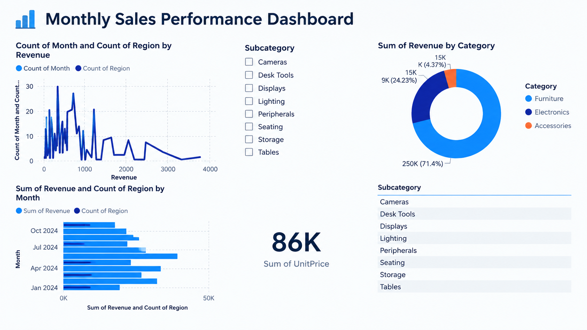

# Monthly Sales Performance Dashboard

An interactive Power BI dashboard that analyzes monthly sales performance and revenue by product category.

## Overview

This project turns sales data into a single interactive report. It helps answer questions such as:

- How much total revenue was generated?
- How did revenue change from month to month?
- Which product categories contribute the most to revenue?

## Dashboard Features

| Visual | What it shows |
| --- | --- |
| KPI card | Total revenue (351K) |
| Bar chart | Revenue and region count by month, January to October 2024 |
| Donut chart | Revenue share by category |
| Product slicer | Multi-select filter by product name |
| Subcategory list | Quick reference for drilling down by subcategory |
| Line chart | Transaction frequency across revenue values |

## Key Insights

- **Furniture** generates the largest share of revenue: 71.4% (about 250K).
- **Electronics** contributes 24.2% (about 85K).
- **Accessories** contributes 4.4% (about 15K).

## Tools

- Microsoft Power BI

## Files

- `Ass2-PowerPi.pbix`: the Power BI project file
- `Ass2-PowerPi-Dashboard-Preview.png`: dashboard preview image

## How to Open

Download `Ass2-PowerPi.pbix` and open it with Power BI Desktop (free from Microsoft).
